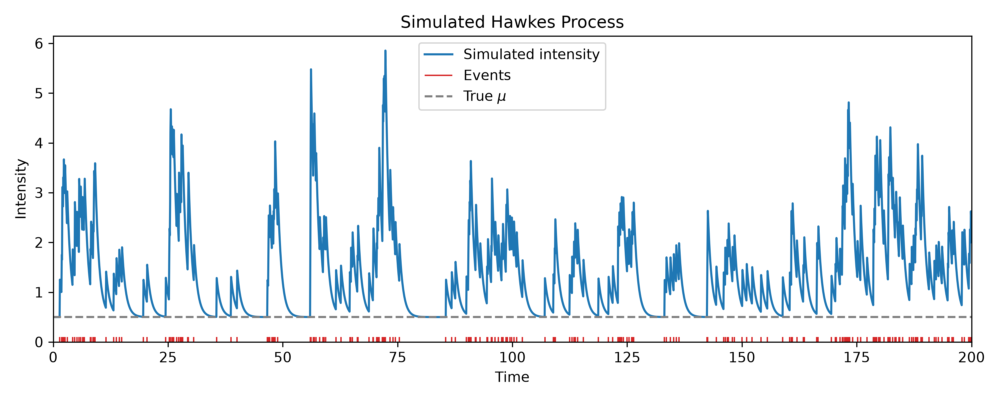
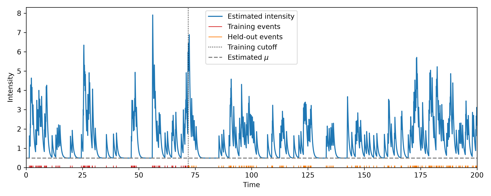
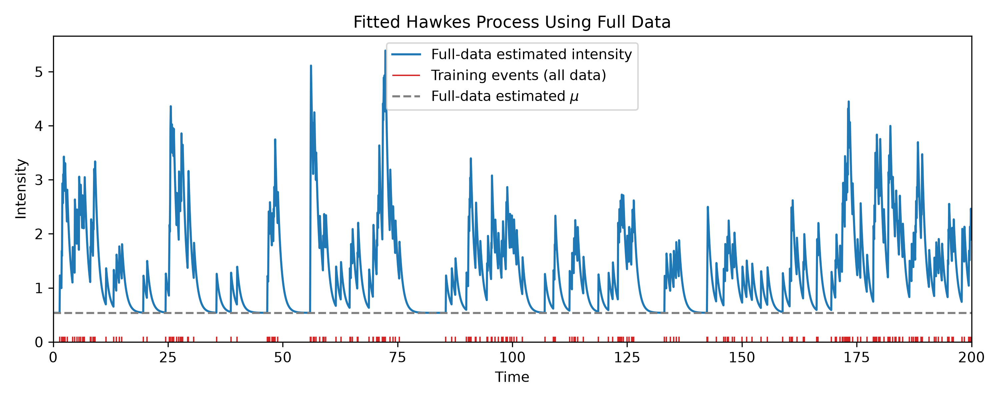
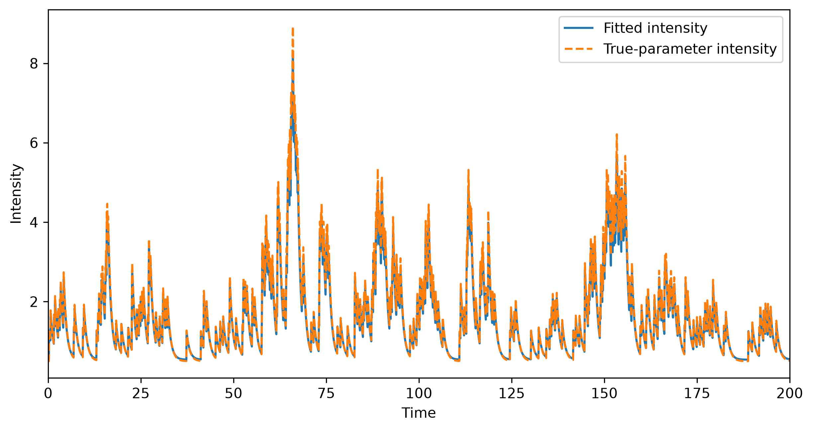

# Exponential Hawkes Process Simulation and Estimation

This repository provides a compact implementation of a univariate Hawkes process with an exponential excitation kernel. It demonstrates event simulation with Ogata's thinning algorithm, maximum-likelihood estimation (MLE), and the effect of fitting the model with either a subset or all of the observed events.

> **Disclaimer:** This is a personal learning project created for educational practice. It is not a research project and should not be treated as original scientific work.

## Model

The conditional intensity is

$\lambda(t)=\mu+\sum_{t_i<t}\alpha e^{-\beta(t-t_i)},$

where:

- $\mu$ is the baseline event rate;
- $\alpha$ is the immediate increase in intensity caused by an event;
- $\beta$ controls how quickly that excitation decays.

The branching ratio is $\alpha/\beta$. A stationary process requires

$$
\frac{\alpha}{\beta}<1.
$$

The MLE implementation enforces positive parameters and constrains the branching ratio to be below one.

## What the Experiment Does

The `mle_and_plot.py` experiment:

1. Simulates one Hawkes-process realization on the time interval $[0,200]$.
2. Fits the parameters using only the first 100 events.
3. Fits a second set of parameters using all simulated events.
4. Evaluates the corresponding conditional intensities on a common time grid.
5. Saves separate figures for the simulated, partial-data, and full-data results.

With the current parameters and random seed, the simulation produces 264 events. The value `total_horizon = 200` is the length of the observation interval, not the number of events.

## Project Structure

```text
hawkes_simulation.py   Simulates event times with Ogata's thinning algorithm
mle_and_plot.py        Runs partial-data and full-data MLE and creates figures
mle2nd.py              Evaluates a full-data fit on an independent simulation
requirements.txt       Python dependencies
figures/               Example output figures used in this README
```

## Installation

Activate a Python environment and install the dependencies:

```bash
python -m pip install -r requirements.txt
```

The project requires NumPy, SciPy, and Matplotlib.

## Usage

Run the simulation and parameter-comparison experiment with:

```bash
python mle_and_plot.py
```

The script prints the true, partial-data, and full-data parameter values and generates:

```text
hawkes_simulated_intensity.png
hawkes_estimated_intensity.png
hawkes_full_data_estimated_intensity.png
```

The versions shown below are stored in `figures/`.

## Results

### Simulated conditional intensity

This figure uses the true simulation parameters $(\mu,\alpha,\beta)=(0.5,0.8,1.2)$. Each event produces an immediate increase in intensity followed by exponential decay toward the baseline.



### MLE using the first 100 events

The partial-data fit uses the first 100 events, ending at approximately $t=71.91$. Red marks indicate training events, orange marks indicate held-out events, and the dotted line is the training cutoff.

The parameters remain fixed after the cutoff. However, the plotted test-period intensity is updated causally as held-out events are observed. 



### MLE using all events

The full-data fit uses all 264 events observed over the complete horizon $[0,200]$. All event marks are therefore training observations.



## Parameter Comparison

For the current random seed, the fitted values are:

| Fit | $\mu$ | $\alpha$ | $\beta$ |
|---|---:|---:|---:|
| True parameters | 0.5000 | 0.8000 | 1.2000 |
| First 100 events | 0.4907 | 1.2714 | 1.8735 |
| All 264 events | 0.5383 | 0.7375 | 1.2349 |

The full-data estimates are closer overall to the simulation parameters. A more accurate fit does not necessarily produce a uniformly higher intensity curve: the fitted intensity depends jointly on the baseline, jump size, decay rate, and realized event history.

## Evaluation

Run the separate evaluation experiment with:

```bash
python mle2nd.py
```

The script fits the model to all 264 events from a simulation over $[0,200]$ with seed 7, then tests the fitted parameters on an independent simulation with seed 2. Both simulations use the true parameters $(\mu,\alpha,\beta)=(0.5,0.8,1.2)$. The optimizer uses fixed starting guesses.

The script prints the test negative log-likelihood divided by the number of training events, $-\log L_{\mathrm{test}}/264$. With the current seeds, the score is approximately **0.3648**. The independent test simulation contains 356 events. When comparing models using the same test realization and denominator, a lower score corresponds to a higher test likelihood.

The script also saves `evaluation.png` in the project root. The solid curve uses the fitted parameters, and the dashed curve uses the true parameters; both conditional intensities use the same test event history. The plot's horizontal axis shows the index of each of the 3,000 evenly spaced evaluation points over $[0,200]$.



## Notes

- Event times from a Hawkes process are history-dependent and should not be treated as independent samples.
- This is an educational univariate implementation with a single exponential kernel rather than a production point-process library.
